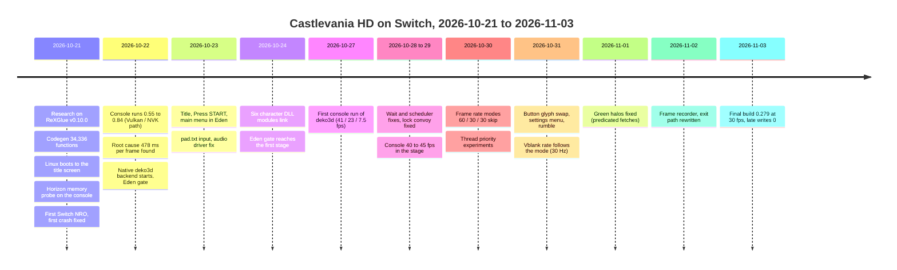
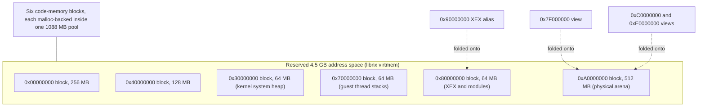
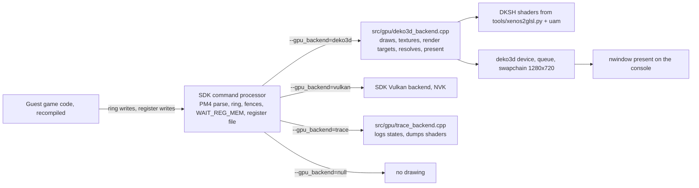

# Porting Castlevania: Harmony of Despair (Xbox 360) to Nintendo Switch

Complete experience of the port, from 2026-10-21 to 2026-11-03. Static recompilation with the
ReXGlue SDK. A native deko3d renderer backend that we wrote. A Horizon host layer for libnx.

Audience: a developer who will port another Xbox 360 (Xenon) game to the Switch with the same toolkit.

How to read this document:

- Each section states one part of the port: the method, the decisions and the numbers.
- Repo paths are relative to the repository root (`cvhd-recomp`).
- The dated journal is `CLAUDE.md`, section "Findings". Every number here comes from it or from the
  scripts and docs named in each section. The journal has the full evidence.
- Terms used in this document:

| Term | Meaning |
|---|---|
| guest | The Xbox 360 program and its memory, as the recompiled code sees them |
| host | The Switch (Horizon, libnx) and its services |
| XEX | The Xbox 360 executable format (PowerPC). The game's main module is `default.xex` |
| STFS | The Xbox 360 package container (`LIVE` = the game package) |
| NRO | The Switch homebrew executable format |
| Eden | A Switch emulator (Windows). It runs our NRO with no GPU or with deko3d. It is our pre-console gate |
| Xenos | The Xbox 360 GPU. Its command stream is PM4 |
| EDRAM | The 360 GPU's on-chip render target memory (10 MB) |
| DKSH | The deko3d shader binary we ship. We make it from GLSL with uam |
| ring | The GPU command ring buffer in guest memory |
| Gate | A check that must pass before the next step. For example, the Eden gate before any console run |

---

## 1. Result and timeline

### 1.1 Result at 2026-11-03

The final build on the console is `cvhd.nro` 0.285.68c6ea3+ (the release: the port menu without the debug
toggles; pushed 2026-11-03 as SHA-1 `3304fc6a...`, 84,408,161 bytes with the game icon). The last user-tested
build before it was 0.279 (`b188895a...`), the same code plus the debug toggles.

| Item | Result | Source |
|---|---|---|
| Frame rate, mode 30 (FRAME RATE setting) | Even 30 fps | User report, 2026-11-03 |
| `late writes` counter in the console log | 0 in all lines of the run | User report, 2026-11-03 |
| Visual artifacts | None reported (no flicker, no green halos) | User report, 2026-11-03 |
| Multiplayer | Not supported. The 360 game is Xbox LIVE only | `CLAUDE.md` 2026-10-30 |
| Title update and DLC | Not applied | `RELEASE-NOTES.md` |
| Sound | Implemented through audout (48 kHz stereo). Hardware result not recorded in the journal | `CLAUDE.md` 2026-10-27 |

### 1.2 Frame rate on the console, by build and scene

| Build | Date | Scene | Result | What it shows |
|---|---|---|---|---|
| 0.55 | 10-22 | Boot | No graphics. `Entrypoint XEX not found` (game data missing on the card) | Data must be copied to the card |
| 0.58 | 10-22 | Konami logo | About 1 fps | First graphics (Vulkan / NVK path) |
| 0.65 | 10-22 | Title | 2.1 fps, 478 ms per frame, constant | GPU work per frame, not CPU |
| 0.84 | 10-22 | Title | 2.1 fps. Thread placement changed nothing | Root cause found (section 5.1) |
| 0.135 | 10-27 | Title | 41 fps (15 s window) | deko3d backend, first console run |
| 0.135 | 10-27 | Main menu | 23 fps | |
| 0.135 | 10-27 | Stage | 7.5 fps | |
| 0.141 | 10-28 | Loading screens | About 12 fps | |
| 0.141 | 10-28 | Stage | 7.5 to 10 fps | |
| 0.177 | 10-29 | Menus | 30 to 60 fps | |
| 0.177 | 10-29 | Stage | 22 to 24 fps | |
| 0.187 | 10-29 | Menus | 60 fps | |
| 0.187 | 10-29 | Gameplay (no profiler) | About 50 fps, no stutter | |
| 0.200 | 10-29 | Stage | 40 to 45 fps, jerky. Frames: 56% at 17 ms, 39% at 33 ms, 4% at 50 ms | Vblank-quantised frame times |
| 0.249 | 10-31 | Stage, mode 30 | Presents at 33.3 ms (96 to 100% under 34 ms). Game steps still mixed 17/33/50 ms | Motivated the 30 Hz vblank (0.250) |
| 0.279 | 11-03 | Stage, mode 30 | Even 30 fps (user report). `late writes` 0 | Final |

### 1.3 Build size history

| Build | NRO size | Cause of change |
|---|---|---|
| 0.29 to 0.42 (first links) | 111 MB, then 142 MB | 142 MB after the dirty-page tracking code |
| 0.135 | 200.9 MB | Compare-chain address fold (replaced by a table in 0.159) |
| 0.159 | 92 MB (from 200 MB) | Address fold by a 256-entry table (taken from hcu-switch) |
| 0.193 | 88.3 MB | Register localisation flags (`cr/ctr/xer/reserved`) |
| 0.196 | 85.5 MB | `non_volatile_as_local` |
| 0.213 | 81.8 MB | Not stated in the journal |
| 0.229 | 84.4 MB | Not stated in the journal. `-O3` (0.223) and CRT hooks (0.224) were in this build |
| 0.279 | 84,396,229 bytes (no icon), 84,408,161 bytes (with icon) | Final |

### 1.4 Timeline

---

## 2. Toolkit and references

### 2.1 Components

| Component | Role in the port | Licence (read the file, not the hosting page) |
|---|---|---|
| ReXGlue SDK v0.10.0 (commit `c94f5eb`), `rexglue/rexglue-sdk` | PowerPC to C++ codegen, host runtime, kernel, Xenos GPU plugin, XMA audio, input, UI | BSD 3-Clause. Portions derived from Xenia (BSD) |
| XenonRecomp, XenosRecomp (hedge-dev) | Ancestors of the ReXGlue codegen and shader translator | Read the upstream files |
| stuntdouble-reignition (`giangra`) | Manifest layout, SDK patch set `patches/sdk/*.patch`, the data pointer scan fix | MIT (its SDK patches are BSD) |
| devkitPro: devkitA64 GCC 16.1, libnx 4.12, newlib 4.6, `switch-ffmpeg` 7.1-5 (has the XMA decoder), `switch-sdl2` | Switch toolchain and libraries | devkitPro licences |
| NVK (mesa-switch `0ff5207`), static `libvulkan.a` | Vulkan path (first renderer) | Read the file |
| uam (Mesa `nv50_ir`) | GLSL to DKSH compiler for deko3d | Read the file |
| Eden (Switch emulator, Windows) | Pre-console gate, screenshots, input scripts | Read its licence. Used as a separate program only |
| Atmosphere, hbmenu, hbloader | Console firmware and launcher. Title takeover mode | Read the files |
| Kefir Hub | Console app that serves the FTP server used by `switch/deploy.sh` | Its own licence |

### 2.2 Reference ports

Ideas and measurements only, unless a row says a file was reused.

| Port | Platform | Used for | Licence | Reuse in this port |
|---|---|---|---|---|
| stuntdouble-reignition | ReXGlue, PC | Manifest, SDK patches | MIT | Patch layout and SDK patch ideas |
| hells-gate-recomp | ReXGlue, PC | Replaces the guest D3D with its own renderer | Read its LICENSE | Route not taken (see 5.2) |
| AC6_recomp | ReXGlue, PC | Keeps the Xenia GPU | Read its LICENSE | Not used |
| CoD3Recomp | XenonRecomp, D3D11 | Not ReXGlue | Read its LICENSE | Not used |
| sa2-nx (Sonic Adventure 2) | ReXGlue, Switch, deko3d | 60 fps on Switch. Memory aliases, codegen flags, spin on the GPU wait | GPL-3 | Methods and measurements only |
| usf4-nx (Ultra Street Fighter IV) | ReXGlue, Switch | 60 fps on Switch. Resolve and clear rounds | GPL-3 | Methods and measurements only |
| hcu-switch (Hard Corps: Uprising) | ReXGlue, Switch | Wait handling, WaitMultiple per-handle waiters (patch 0021), exit (commits 8703eba, 613eed9), address table fold, sync of this tree | GPL-2 | Methods, and the exit and fold code was adapted |
| Guardian Heroes port | ReXGlue, Switch | Same author as the audout driver. Found the DXT pitch bug on its own. Button glyph work | Read its LICENSE | `switch/host/audio/nx_audout_driver.h` is a copy. Check the licence before reuse |
| Conker LR (`conker-lr-xbox`) | Xbox, Switch | Clock scaling (1785 / 768 / 1600 MHz), thread placement, `switch_nx.c` | Own project | Clocks and placement ideas |
| cbfd-switch (N64 port) | Switch | Horizon notes, the exit sequence of commit a1dabfe, NVK SDK build | Own project | Horizon rules (`docs/switch-port/horizon-notes.md` in that repo) |
| Futari (futari-nx) | Shmup | Its published XDK 2.0.x device layout matches this game | Read its LICENSE | Offsets confirmed in this game's code |

### 2.3 Rule for references

- Copy no game data from another port.
- Copy code only after you read its licence.
- Write each borrowed idea into `CLAUDE.md` with its source commit.

---

## 3. Game data

### 3.1 Package layout

The user owns the game. The repository never contains game data.

| Item | Size | Content |
|---|---|---|
| `LIVE` STFS container (`000D0000`) | 378 MB | Title id `0x58410A7A`, content type `0xD0000` (arcade title). Not encrypted. `XEX2` at offset `0x3D000` |
| Title update (`TU_1C422JQ_...`) | 2.4 MB | `default.xexp` (720,896 bytes) and patched `data/` files |
| DLC containers (`00000002\*`) | 11 files | Characters, BGM packs, chapters 7 to 11. Not mounted |

### 3.2 Extraction

- `tools/stfs_extract.py` reads STFS packages. It follows the Free60 layout.
  - Usage: `python3 -I tools/stfs_extract.py <package> <out_dir> [--list]`.
  - Every file is contiguous. The tool reads one hash table per 0xAA blocks.
- The first extraction held 2161 files, 359 MB.
  - `default.xex`: 3,448,832 bytes, version 0.0.1.4, built 2010-07-09.
  - `data/`: `arc`, `enemy`, `gimmick`, `menu`, `opd`, `player`, `player_dll`, `sound`, `stage`, `text`.
- Extract on Windows, not through `/mnt/d` in WSL. WSL reads a 378 MB file through 9P very slowly.
  - Stream the extracted folder into WSL with `tar -C game -cf - . | wsl -u root tar -xf - -C <dest>`.

### 3.3 Title update

- ReXGlue applies a `default.xexp` at run time (`XexModule::ApplyPatch`).
- Codegen reads the base XEX only.
- A run-time patch would change code the recompilation lacks. Keep `default.xexp` out of `game/`.
- Planned path: patch the XEX offline once, then run codegen on the patched image. Not done.

---

## 4. Codegen

### 4.1 Pipeline

```mermaid
flowchart LR
    A[LIVE STFS] -->|tools/stfs_extract.py| B[game/ default.xex + data/]
    B --> C[rexglue init]
    C --> D[cvhd_manifest.toml]
    D -->|rexglue codegen| E[generated/default/*.cpp]
    D -->|rexglue codegen| F[generated/dll_*: six character DLLs]
    G[codegen_flags.toml] --> D
    H[sdk-edits.py templates] -->|rebuild rexglue CLI| B
    H --> E
    E --> I[Linux build: clang-20, Ninja]
    E --> J[Switch build: devkitA64 GCC]
    F --> J
    J -->|ld -r + objcopy per DLL| K[static DLL objects]
    K --> L[cvhd.elf]
    I --> M[cvhd linux binary]
    L -->|switch/build.sh, nro_nacp| N[cvhd.nro with NACP and ASET icon]
    N -->|switch/deploy.sh FTP + SHA-1| O[console sdmc:/switch/cvhd]
```

### 4.2 Manifest and first codegen

- `rexglue init --project-name <name> --xex-path game/default.xex` writes the manifest, `src/main.cpp`
  (`REX_DEFINE_APP`) and `CMakeLists.txt`.
- Codegen runs as a build step. The game CMake links `rex::runtime`.
- The GPU plugin must be named. Set `config.gpu_plugin = "xenos"` and `rexglue_setup_target(... GPU_PLUGINS xenos)`.
  Without it the screen stays black (stuntdouble note).
- First run: `UnresolvedCall` for `b 0x826444A8` from `0x826444B4`. Declare `0x826444A8` in the manifest.
- Result: 77 s, 34,336 functions, 132 `.cpp` files, 136 MB, zero `REX_FATAL` sites.
- Entry point: XEX `0x8263BA90` (header `0x10100`). Image `0x82000000` to `0x82960000`.

### 4.3 Discovery problems and fixes

| Symptom | Cause | Fix | Where |
|---|---|---|---|
| `use of undeclared label loc_8277F258` | Discovery cut a function body at `0x8277F134`. A second entry branched into it | Manifest `[entrypoint.functions.0x8277ECF0] end = 0x8277F2C8` | `cvhd_manifest.toml` |
| "Call to invalid or unregistered function" at `0x822130A8`, `0x825F3398` | Callbacks reached through data pointers | Data pointer scan: 21,080 more functions, 126 interior addresses skipped. Code pointer scan: 173 | SDK patch set (stuntdouble) |
| Warning "Unexpected float16_4 pack instruction" (18 times) | `vpkd3d128` FLOAT16_4 at `0x82754A54` to `0x82755540` | Watch at run time. Not fixed | Codegen log |
| Warning "Function 0x828847A0 is 1357332 bytes" | Discovery ran through data | Check whether it is called. Not fixed | Codegen log |

### 4.4 Character DLL modules

- The player characters live in `data/player_dll/dll*.dll`. Each is an XEX module with its own code.
- The main image covers `0x82000000`. Each DLL loads at its own base (Soma at `0x83090000`).
- The manifest lists the six DLLs as `[[modules]]`. Six DLLs recompile in about 6 s each.
- Function tables overlap if the main table sits next to the DLL images. The codegen emits `REX_TABLE_BASE`:
  - main table `0x80100000`;
  - a DLL table at `0x81000000 + 2*(code_base - 0x83000000)`.
- Linux loads the DLLs as shared libraries (`libcvhd_dllSoma.so`). The kernel state loads by the bare name `cvhd_dllSoma`.
- The Switch has no `dlopen`. The Switch build links each DLL as a static object (section 6.5).

### 4.5 Register and flag decisions (`codegen_flags.toml`)

Flags reduce the work of generated code. Each flag was checked with an audit tool before it was enabled.

| Flag | State | Measured effect | Audit |
|---|---|---|---|
| `skip_msr` | On (0.183) | Removed one process-wide recursive mutex per `mfmsr` (3,800 sites). About 13,000 contended locks per second went away | The host delivers no asynchronous interrupts into guest code, so the lock is not needed |
| `cr`, `ctr`, `xer`, `reserved` as locals | On (0.193) | NRO 92.2 to 88.3 MB. Eden 31.4 fps (0.184: 27.3) | Local variables, no ABI effect |
| `non_volatile_as_local` | On (0.196) | `__savegprlr` and `__restgprlr` calls: 29,000 to 0. NRO 85.5 MB. SEH funclets need hand-over | `tools/nonvolatile_audit.py` |
| `share_registers` on 7 hidden-argument readers and one stack probe | On (0.207) | Hidden float and vector arguments (MSVC interprocedural allocation) | `tools/locals_audit.py`: 0 GPR cases left |
| `non_argument_as_local` | On (0.207) | `ctx.r11` accesses 236 instead of hundreds of thousands | Per-function keep list |
| `skip_lr` | Off (parked) | Expected 1 to 2% class. 89,508 `ctx.lr` stores. 14 `mtlr r3; blrl` sites break under it | Needs an SDK edit that keeps `mtlr` |

Rules:

- After a template change, rebuild the host `rexglue` CLI, then run `rexglue codegen cvhd_manifest.toml --ignore-stamp`.
  A plain rerun writes 0 files.
- Delete `generated/default/cvhd_pch.h` to regenerate the header after a pch template change.
- The codegen stamp ignores template changes.

### 4.6 Hooks for guest functions

- `DEFINE_REX_FUNC(name)` makes each guest function a weak alias of `__imp__name`.
  A strong `sub_X` in `src/guest_hooks.cpp` replaces the generated body at link time.
- Used for:
  - the GPU-wait iteration `sub_82620BD0` (sleeps 20 us before its 32x `db16cyc` spin, 0.221);
  - the CRT copies `memcpy`, `memmove`, `memset` (0.224).
- The CRT copies were found by call-site count and by their first instructions (`sub_8273A030` memcpy with 1208 call sites,
  `sub_8273AD00` memmove, `sub_8273A590` memset with 606 sites). Each DLL carries its own copy at the same relative offsets.
- A hook copies with one `std::memmove` or `std::memset` on host pointers. It also marks dirty pages for the GPU.
  A host copy marks nothing by itself. That gap caused a stale-texture class (Konami logo).
- The module link keeps hooked names global (`tools/module_keep_symbols.py` reads `src/guest_hooks.cpp`).
- Check after each hook change:
  `nm cvhd.elf | grep -E " [A-Za-z] sub_(8273A030|830B2A90)$"` must show `T`, not `W` or `t`.

### 4.7 Audit and analysis tools

| Tool | What it finds | When |
|---|---|---|
| `tools/nonvolatile_audit.py` | Functions that read a callee-saved register before writing it | Before enabling `non_volatile_as_local` |
| `tools/locals_audit.py` | Read-before-write of localised registers | After enabling local registers |
| `tools/census_gen.py` | Counting wrappers for each recompiled function in a range (calls, callers, PM4 words) | Finding the game's Direct3D entry points (M1 census) |

---

## 5. Linux build and test host

### 5.1 Build (from nothing)

1. Install packages: `clang-20 cmake ninja-build libegl-dev libgl-dev libvulkan-dev mesa-vulkan-drivers xvfb xdotool
   imagemagick glslang-tools pulseaudio python3-pil`, and the SDL build dependencies.
   - The SDK needs clang 20. Clang 18 lacks `std::expected` with libstdc++ 13.
   - apt.llvm.org's clang-20 conflicts with Ubuntu 24.04's `libllvm20`. Remove the llvm.org list first.
2. SDK: `git clone https://github.com/rexglue/rexglue-sdk`, check out `c94f5eb`. Run `git submodule update --init --depth 1`.
3. Apply `patches/sdk/*.patch` (stuntdouble). Then run `python3 switch/sdk-edits.py <sdk>` **once** on the clean SDK.
   A second run must change nothing. See section 6.2.
4. Game data: `python3 -I tools/stfs_extract.py <package> game`. No `default.xexp` in `game/`.
5. Build the `rexglue` CLI. Run codegen (`rexglue codegen cvhd_manifest.toml`, about 35 to 77 s).
6. Build the game: `cmake --preset linux-amd64-release -DREXSDK_DIR=<sdk> ...`, then `scripts/linux-build.sh`.
   About 25 minutes on 12 jobs, about 40 minutes on 4 cores.
7. Sound: the SDK's SDL3 has no dummy audio driver. Run PulseAudio with a null sink, or leave the audio off and accept
   that the attract transition waits on the audio engine (section 7.9).

### 5.2 Run and test

| Command | Result |
|---|---|
| `scripts/linux-run.sh <seconds> [args]` | Xvfb plus lavapipe. Screenshots every 10 s. Logs in `/root/cvhd/runs/<stamp>/` |
| `scripts/linux-run.sh 120 --gpu_backend=null` | No drawing. Linux findings: swap 720 at 120 s. The handover states about 30 fps |
| `scripts/linux-run.sh 100 --gpu_backend=trace --dump_shaders=<dir>` | Logs every distinct draw state and dumps shaders |
| `scripts/linux-drive.py --out <dir> --steps "waitlog 'swap #540' 600; key Return" -- ...` | Presses keys by log event |
| `tests/run-untile-test.sh` | Compares the new untiler with the SDK's (160 of 160 equal) |

- Use log events (`waitlog`) to drive input, not swap counts. Swap-number timings pressed keys before the menu existed.
- One test at a time. Kill by PID. Do not use `pkill -f` with a pattern that the shell command contains.
- Input on Linux: the SDK's keyboard driver (`--mnk_mode=true`): Return = Start, space = A, BackSpace = B,
  Shift+arrows = d-pad.
- `src/gpu/dk_gl/` is an OpenGL stand-in for libdeko3d (headless EGL and Mesa llvmpipe, GL 4.5). The deko3d backend
  compiles on Linux against it. It loads `shader_<hash>.vert|frag|geom.glsl` (translator output).
  - Speed: about 1.5 swaps/s on four cores.
  - `CVHD_DK_START_SWAP=N` and the file `<dump dir>/skip_on` make it a null backend to reach a scene quickly.
  - `CVHD_DK_GL_DUMP=<dir>:<every N>` writes frames as PPM. `CVHD_DK_DUMP_DIR=<dir>` writes each uploaded texture.
  - `CVHD_DK_GL_POISON=1` fills new images with noise (finds uninitialised memory).
- `docs/LINUX-TEST-HOST.md` has the full procedure.

### 5.3 Pitfalls on the build host

- `rsync -a` keeps the Windows mtime. A changed hook file can look older than its object, and ninja skips it.
  Use `rsync --no-times --checksum` for the chain scripts. A changed file then gets the transfer time.
- `rsync --delete` into the build tree must exclude `out`, `game`, `generated` and `.git`.
  Without `generated/` the link fails on `PPCImageConfig`. Rerun codegen to fix it.
- Check the free disk space before a build (a Python rewrite once truncated `switch_nx.cpp` to 0 bytes on a full disk).
- Check `uptime` in WSL before an Eden run. Runs during another build are invalid (section 10.1).

---

## 6. Switch build

### 6.1 Toolchain and layout

- devkitA64 GCC 16.1 through `$DEVKITPRO/cmake/Switch.cmake`, Ninja, Release.
  Clang is not needed. The Linux build uses clang 20.
- `switch/build.sh` does the whole build in WSL:
  1. runs `switch/sdk-edits.py` on the SDK;
  2. writes the version (`0.<commit count>.<sha7>`) into the NACP and `cvhd_version.h`;
  3. configures and builds `out/build/switch/cvhd.nro`;
  4. writes `out/build/switch/stage/` (NRO, `shaders/*.dksh`, marker files).
- `switch/deploy.sh <ip> [push|logs]` pushes the NRO, reads it back, compares SHA-1, and fetches logs.
- Build cost: 141 build steps. Full tree about 12 minutes. Incremental about 3 minutes.
  `cvhd.elf` is 680 MB with debug info. Keep each pushed ELF by version (`/root/cvhd/elf/`) for `addr2line`.

### 6.2 `switch/sdk-edits.py`: the SDK patch script

The script edits the ReXGlue SDK checkout for the Switch. It is the record of every SDK change. It is about 1,900 lines.

- Idempotent: each edit checks its own marker first. A second run must leave `git -C <sdk> diff --stat` unchanged.
- Anchors: an edit replaces an `old` text with a `new` text. `STRICT=1` makes a missing anchor fatal on a fresh checkout.
- Rule 1: write every insert in its final form. A later corrective edit that changes an earlier insert breaks idempotency.
  The next run finds its `old` again and inserts again (0.43 had `rex_nx_mark` twice). Symptoms: duplicate `CpStats`.
- Rule 2: when a template changes, restore the template from git before the script runs (the chain scripts do this for
  `command_processor.cpp`, `xthread.cpp` and `dll_targets_cmake.inja`).
- The rule blocks (section headers of the script, in order):

| Block (script comment) | What it does |
|---|---|
| CMake: toolchain, platform, library types | `REX_PLATFORM_SWITCH`, `-ffp-contract=off` instead of `-ffp-model=strict`, static runtime and plugin |
| Headers | Switch include files |
| Sources | Switch source files and their registration |
| Guest memory | One R/W view. The other views folded in software (section 7.2) |
| Threading without signals | `threading_switch.cpp` (no signals, no robust mutexes) |
| GPU write tracking | Dirty bytes from the store macros (section 7.4) |
| The libnx pad driver | `switch/host/input/` |
| VkPipelineCache on the SD card | Pipeline cache file |
| Step marks | Flushed log lines in `Runtime::Setup`, `LoadModule`, `LaunchModule`, XMA setup, VFS |
| `std::filesystem::absolute` | Keeps `sdmc:/` paths as given (newlib adds `/`) |
| Null GPU backend | `--gpu_backend=null`: command processor runs, nothing is drawn |
| GuestPtr fold | Every kernel export pointer goes through the Switch fold |
| Vblank and interrupt marks | Diagnose the vblank stall |
| Host clock | `armGetSystemTick()` at 19.2 MHz (section 7.7) |
| `SetActiveCpu` warnings | The warning on every call (host with fewer than 6 cores) is removed |
| Thread priorities | The game's priorities reach Horizon (section 7.5) |
| Extra GPU backends | Trace backend and deko3d backend compiled into the plugin |
| `vkDestroyInstance` | Loaded with the instance handle |
| FPS line | Perf counters on in the Release build |
| Missing-file opens | A miss in the in-memory tree does no host lookup (section 7.8) |
| Directory opens | Directories open without a host handle |
| WAIT_REG_MEM statistics | Polls and sleep time per second |
| Audio worker | Leaves at once (no backend) or uses the audout driver |
| Command processor phase timers | Once per second, every platform |
| non_argument_as_local | Codegen builders (rebuild `rexglue` after this edit) |
| Phases in Vulkan `IssueDraw` | Timers, printed once per second |
| GPU work per second | Transfer passes, texture loads |
| Guest DLL modules | Each recompiled module as a shared library on Linux, or a static object on the Switch |
| Function tables | DLL dispatch tables moved out of the way of the DLL images |
| Vblank rate by fps mode | `rex_nx_vblank_divider` (0.250) |
| PPC memory barriers | `sync`, `lwsync`, `eieio` emit fences on an ARM host (0.263) |

### 6.3 SDK changes for the Switch (summary)

- `REX_PLATFORM_SWITCH` and `REX_PLATFORM_LINUX` (not GNU Linux) in `platform.h`.
- GCC allowed. `-ffp-contract=off` instead of `-ffp-model=strict`: GCC fuses multiply and add on aarch64 by default.
- `rexruntime` and `rexgpu-xenos` are static. The plugin is created by a direct `rex_gpu_create` call (no `dlopen`).
- No SDL3. An interface stand-in. Entry: `windowed_app_main_nx.cpp`.
- Vulkan: `VK_NN_vi_surface` through `api.h`, `instance.h`, `vulkan_instance.cpp`, `vulkan_presenter.cpp`, `surface.h`.
  - Surface loader: a missing `#ifdef` branch left `vkCreateViSurfaceNN` null, and the first run crashed at pc 0.
    The cause: each surface extension needs its own load block (fixed in `sdk-edits.py`).
- `input_backend` `nop` and `NopAudioSystem` (later replaced by the audout driver, section 7.11).
- FFmpeg: `config_switch_aarch64.h` (no `arc4random`, `mmap`, `strerror_r`).
- `fiber.h` with a 24-word context (`switch/host/fiber_nx.cpp`).

### 6.4 GCC pitfalls (found in order)

| # | Symptom | Cause | Fix |
|---|---|---|---|
| 1 | 34,151 undefined `sub_*` references | `__attribute__((alias))` before `extern "C"` is ignored by GCC | Put the attribute after the declarator (clang accepts both) |
| 2 | Assembly files get `-include` errors | `add_compile_options` reaches `.S` files | `$<COMPILE_LANGUAGE:C,CXX>` guard |
| 3 | `fileno`, `fdopen`, `tm_gmtoff` missing | Strict `-std=c++23` hides them in newlib | `_GNU_SOURCE`, `SPDLOG_NO_TZ_OFFSET` |
| 4 | FFmpeg `AVERROR(-ptr)` errors | `strerror_r` is the GNU `char*` form | `HAVE_STRERROR_R 0` |
| 5 | `vulkan.hpp` loader errors | No Horizon branch in its DynamicLoader | `VULKAN_HPP_ENABLE_DYNAMIC_LOADER_TOOL=0` |
| 6 | Codegen rewrites `rexglue.cmake` | Cross build needs the host CLI as a target | `REXGLUE_HOST_CLI` |

### 6.5 Static DLL modules (no `dlopen`)

Each character DLL is joined into one object and localised:

1. `ld -r` joins the module's objects. Filter the precompiled header with `[.][pg]ch$`.
   A parenthesised regex broke the generator expression (CMake split it into linker arguments).
2. `objcopy --keep-global-symbols=<list>` keeps the module's two entry points and the weak inline COMDAT symbols global.
   Making all symbols local dropped the COMDATs, and the link failed with "defined in discarded section".
   `tools/module_keep_symbols.py` builds the keep list from `nm`.
3. Weak symbols with an `__imp__` twin are guest function aliases. They must be local. Otherwise the final link
   resolves `xstart` and `__savegprlr_N` to the first DLL in link order. The main thread then ran the DLL's CRT start
   and ended at once (0.134 gate failure). The keep list shrank from 863 to 13 names per module.
4. The keep list is passed without literal quotes (VERBATIM quoting bug).

Check: `nm cvhd.elf | grep " [A-Za-z] xstart$"` shows one `W` (`generated/default`) and six `t`.

### 6.6 Versioning, NACP and icon

- Version string: `0.<commit count>.<sha7>`. It appears in the NACP (what hbmenu shows), the first log line, and
  `cvhd_version.h`. Every log and every NRO can be matched to a commit.
- hbmenu showed "Unspecified Author 1.0.0" for every build at first. devkitPro's `nx_create_nro` takes only
  `NACP`, `ICON` and `ROMFS`. The name, author and version arguments were ignored.
  Fix: `nx_generate_nacp` in `CMakeLists.txt`.
- `tools/nro_nacp.py` reads the NACP back from the asset section. `switch/deploy.sh` refuses a push when the NACP
  version differs from `cvhd_version.h`.
- Icon: the game's title thumbnail (the 64x64 PNG in the STFS header at offset `0x571A`) was upscaled to 256x256
  JPEG and written into the asset section (`ASET`) of the NRO. The icon was a manual step after staging.
  The step was skipped for 0.279. Lesson: put the icon step in the build, not after it.
  - The icon and its script are not in the repository (`/root/cvhd/icon/nro_set_icon.py`, stage copy `stage_0.279i`).
- The NRO's asset section (icon 6,285 bytes, NACP 16 KB) lies after the NRO body. hbl does not load it.

---

## 7. Horizon host layer

The host layer is `switch/host/`. It implements what the SDK expects from its POSIX and Windows back ends:
memory, files, threads, fibers, exceptions, a window, input and audio.

### 7.1 Memory probe on the console (the decision table)

Probe source: `switch/probe/`. Run on the console in title takeover mode, 2026-10-21. Memory 3285 MB total.

| Test | Result | Consequence |
|---|---|---|
| `svcMapProcessMemory` (own handle, heap source) | 0xE401 (InvalidCurrentMemory) | Heap memory cannot be mapped a second time. No R/W aliases of the arena |
| CodeMemory `MapOwner` (RW) + `MapSlave` (RX) | Both 0. A write through the owner shows in the slave | Exactly two views: one RW, one read-only. Fill memory after mapping |
| `svcSetMemoryPermission` / `svcSetProcessMemoryPermission` (R) | 0xD401 | No page-permission toggling. No fault-based write watches |
| CodeMemory handles | 9 created, the 10th fails (0xCE01) | Guest arena must fit in 8 or fewer code-memory blocks |
| `svcMapPhysicalMemory` (reserved address) | 0xFA01 | No on-demand commit at arbitrary addresses |
| Fault resume | Not reached | Moot: nothing can be reprotected |
| Exit by `+` | Crash in hbl (no module at the PC) | Use a clean exit (section 7.9) |

Note from other ports (research, not tested in this port): `svcMapProcessCodeMemory` followed by
`svcMapProcessMemory` gives true aliases in every view (sa2-nx). This port did not test that path.
It stays a candidate. The software fold works, and no alias probe was run.

### 7.2 Memory design

Guest views (ReXGlue `map_info`, file offsets in its memory mapping):

- `0x00000000` (4 KB pages), `0x40000000` (64 KB pages), `0x7F000000` (GPU writeback window: physical 0 to 16 MB),
- `0x80000000` and `0x90000000` (the XEX, same file offset),
- `0xA0000000` (physical arena, 512 MB), `0xC0000000` and `0xE0000000` (the same arena through other views).

On Horizon the design is:

- Each block is one `CodeMemory` mapping. Six blocks fit in the 8-block limit. Total 1088 MB of RAM.
- Folding: `REX_PHYS_HOST_OFFSET(addr)` returns the offset that maps an alias onto its block:
  - `0xC0000000 to 0xDFFFFFFF`: `-0x20000000`;
  - `0xE0000000 to 0xFFFFFFFF`: `-0x40000000`;
  - `0x90000000 to 0x9FFFFFFF`: `-0x10000000` (onto `0x80000000`);
  - `0x7F000000 block`: `+0x21000000` (onto `0xA0000000`).
- Cost: one compare on each guest access. Most accesses take the first branch.
  A 256-entry table replaced the compare chain (0.159): NRO 200 MB to 92 MB, Eden stage 6.7 to 10.8 fps.
- The heaps allocate bottom up only (the top-down flag is ignored) so that each heap stays inside its block.
- Commits outside a mapped block return null with an `[nx_memory]` line. Silent aliasing does not happen.

### 7.3 The memory pool and the malloc failures

The guest needs about 1.1 GB of RAM. Title takeover gives about 3.2 GB. Several boots failed for the same reason: newlib's
`malloc` refused large allocations after a big chunk sat in its arena.

| Build | Symptom | Cause | Fix |
|---|---|---|---|
| 0.63 | `no RAM for the 0x0 block (256 MB)` | `aligned_alloc` of 256 MB returned null. Overlay created first | Log heap state (`mallinfo`). Exit cleanly |
| 0.79 | Same | newlib extended its arena by 256 MB and still returned null | One 1088 MB pool allocated as the first allocation |
| 0.82 | `nvkmd-switch: out of host memory` at swapchain | The 1088 MB chunk sat in newlib's arena. NVK's allocations were refused | The pool is carved from the top of libnx's heap by lowering `fake_heap_end`, so malloc never holds the chunk |
| 0.84 | Fixed | Self-test: `malloc self-test: 256 MB ok, 1 MB ok` | Lesson: check the allocator state in the log at each step |

- The pool is carved before any other heap activity.
- Lesson: a single large allocation from a general allocator interferes with other allocations. Carve the pool from the
  top of the heap and keep it out of the allocator's arena.

### 7.4 GPU write tracking without page faults

Horizon does not allow page protection (probe). The SDK tracks GPU-visible memory with page faults. Replacement:

- A dirty byte per 4 KB page of the physical arena (`rex_nx_dirty`, 128 KB) and a coarse map (`rex_nx_dirty_coarse`, 512 bytes, 1 MB per byte).
- Set by the codegen store macros (`REX_STORE_*`, `REX_MM_STORE_*`, vector stores, `stwcx`, `dcbz`) when the address is in the arena.
  The mark happens after the store. A flush between store and mark cannot lose the write.
- Set by host writes into guest memory: file reads (the bounce copy in `XFile::Read` calls `rex_nx_mark_range`), `RtlFillMemoryUlong`
  (a known gap: one call site, `sub_82633D08`, marks nothing).
- The SDK's `SharedMemory::RequestRanges` calls `rex::memory::nx::FlushDirtyPages`, which feeds the SDK's own
  watch bookkeeping. The deko3d backend reads the bytes itself before each draw and resolve.
- Cost of the store mark: a compare and a byte store per guest store. Accepted.
- A dirty page scan rescans regions that were dirty lately. The previous frame's pages are stamped again
  (vector stores mark before the store, and ARM can publish the coarse byte first; 0.265 to 0.268).
- Textures are uploaded again when any page of theirs is newer than their fill (section 8.5).

### 7.5 Threads and the scheduler

Horizon schedules threads by base priority. Priorities 0x3B and below are time-sliced (10 ms). Higher priorities preempt.
This matters because the guest spins and the command processor polls.

Final placement on the Switch (0.76 onward, `switch/host/switch_nx.cpp`, `place_thread`):

| Thread | Core | Priority | Why |
|---|---|---|---|
| Main XThread | 0 | 0x3B (0x3A later) | Recompiled main game loop |
| GPU Commands | 1 | 0x28 | Preempts any guest thread at once. Polls WAIT_REG_MEM |
| GPU VSync | 2 | 0x27 | Vblank source |
| Audio and XMA | 2 | | |
| Other guest `XThread*` | 0 to 2 | 0x3B | Time-sliced. Dealt round robin (`__wrap___syscall_thread_create`) |

- 2 MB host stacks for guest threads (not 16 MB). Other ports note that 16 MB stacks fragment the heap, and they pool stacks.
- Thread handles leak without a reaper.
- The game's own priority requests were recorded (`[nx] game priority`). Honouring them put the background threads
  above the job workers. The Eden fps fell from 35.7 to 32.7 (0.241). Both knobs are off by default:
  `sdmc:/switch/cvhd/boost` (job workers at 0x3A) and `sdmc:/switch/cvhd/gameprio` (game's own requests).
  The console decides. The journal has no console result for these knobs.
- `svcSleepThread(0)` yields only to the same priority (sa2-nx note). A yield does not help across priorities.
- `thread_local` is a function call (`__aarch64_read_tp`) on this toolchain. Cache the pointer in hot code.

### 7.6 Locks, waits and the lock convoy

The biggest CPU waste of the port was in waits. Each item was measured on the console or in Eden.

| Problem | Measure | Fix | Build |
|---|---|---|---|
| Multi-object waits polled every 1 ms | Audio worker 49% of a core with nothing to do (console) | Each signal notifies a shared condition variable. 20 ms cap against lost wakeups | 0.69 |
| Multi-object waits: last millisecond spun | 520,000 "timeouts" per 2 s (Eden 0.144) | Absolute deadline (`wait_until`) | 0.146 |
| Alertable waits round time left down to 0 | 59,000 waits per 2 s (command processor's 5 ms idle wait) | Round up to a millisecond | 0.152 |
| Lost wakeup in multi-object wait | Up to 20 ms per signal in between | Generation counter and a pass through the mutex | 0.144 |
| Signal and release under the object mutex | Lock convoy: each woken waiter blocked again on the mutex (Eden main thread 64% on reacquire) | Notify after the mutex is released. `notify_one` for release of 1 | 0.170 |
| Every object signal woke every multi-waiter | XMA decoder and audio worker wake constantly | Per-handle waiter list; `NotifyMulti()` wakes that handle's waiters only | 0.212 |
| Recursive mutex contention (game's critical sections, malloc lock) | 27,000 contended locks per 2 s | Spin briefly, then yield with core migration, then sleep 20 us | 0.152, 0.182 |
| Host-side `mtmsrd` locks (global critical region) | 13,000 contended locks per second | `skip_msr` (codegen flag) | 0.183 |
| Plain wait spins 30 us before sleep | 62% of spins hit (Eden) | File `waitspin_us` | 0.152 |

- Timed condition waits are exact. `[nx] condbench`: a 20 ms wait takes 20.6 ms. `[nx] sleepbench`: a 1 ms sleep takes 1.00 ms.
- A polled wait is a bug class. Count it: add a counter for "ended by the cap" or for "wait(0) loops".
  Three bugs were found this way (multi-wait, alertable wait, rmutex).
- `svcArbitrateLock` hands a contended mutex to the waiter inside the kernel. On cores shared by time-sliced
  threads, the lock then waits for the owner's time slice.

### 7.7 Clock

- The Switch clock source is `armGetSystemTick()` at 19.2 MHz (`switch/host/...`, SDK edit "Host clock on the Switch").
  The first version used `clock_getres(CLOCK_MONOTONIC_RAW)`. libnx does not serve that clock. The frequency was 0 Hz.
  No vblank ever fired, and every time-based kernel wait stalled. Eden exposed this in the no-GPU gate.
- Clock speeds: CPU 1785 MHz, GPU 768 MHz, memory 1600 MHz through clkrst with a sys-clk guard
  (`switch_nx.cpp`).
- Clock scaling by the guest (`UpdateGuestClock`) takes a mutex per `mftb`. `--clock_no_scaling=true` removes it.

### 7.8 File system

| Problem | Measure | Fix |
|---|---|---|
| Boot takes 50 s | 25 optional file probes at 2 s each | A missing path on the Switch returns "not found" at once. `sdmc:` is FAT (case-insensitive), so the exact-name stat is the final answer (0.74) |
| Directory open fails (`game:\data\player_dll\` gives STATUS_NO_SUCH_FILE) | `OpenFile` split a trailing separator into an empty name. libnx cannot `open()` a directory | Strip trailing separators. A directory opens as a host file with no handle (Read, Write and SetLength refuse) |
| libnx fs IPC jams on a code-memory mapping | Horizon note of the Xbox port | `XFile::Read` and `Write` bounce through a heap buffer on the Switch |
| `std::filesystem::absolute("sdmc:/x")` prepends `/` on newlib | `status()` throws. Crash at 0.41 | Keep the path as given on the Switch |

- Stage loading from SD is slow (libnx fs IPC per open and read). The black screen at boot was SD I/O.
  An asset pack (as sa2-nx did) would fix it. Not done.
- Each successful open came from the tree built at mount. The tree was never the cost.

### 7.9 Exit sequence

Exit caused the most surprising failures. Each case is recorded.

| Build | Exit method | Result |
|---|---|---|
| Probe (0.2x) | Exit by `+` | Crash in hbl. Returns to hbl with threads and handles alive |
| 0.254 | `_exit(0)` from the port menu | libnx exit closed services (nvdrv, audout, hid) while threads still used them. Error screen |
| 0.256 to 0.272 | `userAppExit` then bare `svcExitProcess` | Applet system reports the application as crashed (error screen) |
| 0.274 | `ISelfController::Exit` (`serviceDispatch(appletGetServiceSession_SelfController(), 0)`), then `__libnx_exit(0)` | Eden: clean exit in 7 ms. Console result for 0.276 and 0.279 not recorded in the journal |

The sequence in `switch/host/switch_nx.cpp` (`rex_nx_quick_exit`), from hcu-switch:

1. Write the exit line to the log and flush it (`[nx] exit: <why>: the process ends now`).
2. `userAppExit()` (stops the sampler and log threads, restores clocks). Guard against its second run.
3. Pause every other registered thread (`svcSetThreadActivity`). Nothing uses nvdrv, audout or hid while services close.
4. Send `ISelfController::Exit`. libnx sends it only for NSOs. For NRO title takeover, the app must send it itself.
5. `__libnx_exit(0)`.

Crash reports during the exits (0.272, 0.276, 0.279 launches) were **not** our NRO. They were a thread of the
Kefir Hub app that kept running after our exit. Three signs showed it: the faulting PC did not belong to our ELF
(`scratchpad/find_base.py` found no base), the data region matched the Hub's `bss`, and the Hub has 32 KB threads
while our NRO starts all threads at 2 MB. Rule: a run that starts prints `[nx] nro base` as its second log line.
A run without it did not start.

### 7.10 Input

- `switch/host/input/nx_input_driver.cpp`: the libnx pad as gamepad 0. Positional mapping: Xbox A (bottom) = Switch B, and so on.
  `+` and `-` are START and BACK. ZL and ZR are triggers. Sticks are the sticks.
- The driver reads the current HID state at each game poll. It has no queue. Poll rate: 60 per second at 60 fps, 30 at 30 fps.
- Rumble: the 360 left and right motors map to `HidVibrationValue` amplitudes (160 and 320 Hz) on the pads in use.
  The game sends XamInputSetState about 25 times a second. Not felt in the journal beyond the code.
- Scripted input for tests: `sdmc:/switch/cvhd/pad.txt`. Each line: `<seconds>:<BUTTONS>[:<hold ms>]`.
  Tokens: START BACK A B X Y LB RB LT RT UP DOWN LEFT RIGHT LS RS, chords with `+`, stick deflection `RSDOWN` for a hold.
  Seconds count from the first pad poll. Hold default 200 ms. Use 400 ms at low fps, since the game polls once per frame.
- Eden keyboard input through Qt was unreliable. `pad.txt` replaced it. It also works on the console.
- Local co-op: the console has one local pad (section 12).

### 7.11 Audio

- The SDK's `nop` audio system refused to create a driver. `XAudioRegisterRenderDriverClient` failed at boot, so the
  game's audio engine never called its render callback, and the attract transition waited on it (the fade stuck,
  0.112). Fix: the nop system creates a driver that "plays" each submitted frame (256 samples at 48 kHz, 5.33 ms) by
  releasing the client's semaphore.
- Real output: `switch/host/audio/nx_audout_driver.h` (a copy of the Guardian Heroes port's audout driver, 0.141).
  48 kHz stereo, signed 16-bit, 2 buffers of 1024 samples, device-paced. Mute file `sdmc:/switch/cvhd/mute`.
  Eden showed 36 underruns in the first minute (0.141). Later Eden runs showed no problem in the journal.
- Audio worker: the SDK's audio worker spun on the wait (49% of a core) until the condition-variable fix (section 7.6).

### 7.12 Fibers and exceptions

- `switch/host/fiber_nx.cpp`: callee-saved context switch in assembly (x19 to x30, sp, d8 to d15). Newlib has no `ucontext`.
- `switch/host/exception_handler_nx.cpp`, `seh_nx.cpp`: no faults are used (no page protection). The handlers print the
  crash register dump and the exception type.
- Libnx's exception path never resumes a faulting store (checked in `libnx.a`). Not needed: the port avoids faults.

### 7.13 Logs and version evidence

| Log | Content |
|---|---|
| `sdmc:/switch/cvhd/cvhd_log.txt` | Our stdout: `[nx]`, `[nx_memory]`, `[clock]`, `[dk]`, `[rec]` lines. Flushed and fsync'd twice a second |
| `sdmc:/switch/cvhd/cvhd_rex_log.txt` | The SDK's log. Rotates at 5 MB into `cvhd_rex_log.1.txt` |
| Crash reports | Atmosphere writes them to the SD card. Symbolise with `aarch64-none-elf-addr2line -e <elf>` after subtracting `[nx] nro base` |

Log lines that matter most:

| Line | Meaning |
|---|---|
| `[nx] nro base 0x...` | Our NRO started. Subtract it from crash addresses |
| `[nx] launch: application (title takeover)` | Title takeover worked. An applet warning means the launch type differs |
| `[nx] fps N, frame M ms mean ... (F frames: a <=17 ms, b <=34, c <=51, d longer)` | Frame time histogram per second |
| `[nx] busy/frame (N frames): <thread> X ms` | CPU work per frame per thread, waits removed |
| `[nx] cpu: name N% ...` | Thread CPU share (a thread blocked in a kernel stub counts as waiting) |
| `[nx] pc <thread> ...` | Sampler: program counter by 256-byte bucket. Needs the file `prof` |
| `[nx] gpu waits: N sleeping polls` | Command processor polls of WAIT_REG_MEM |
| `[nx] dk time/s: ...` | Backend time: draws, uploads, fence, `late writes`, GPU time from timestamps |
| `[nx] exit: N threads paused` | Exit sequence reached the pause loop |

---

## 8. Rendering

### 8.1 Why the first renderer gave 2 fps: the root cause

The first renderer was the SDK's Xenia-derived Vulkan backend on NVK (the Tegra X1 driver).

Measured on Linux with lavapipe and on the console at build 0.84 (2.1 fps, 478 ms per frame):

| Per frame, title screen | Count | Source |
|---|---|---|
| Draws | 119 | Command processor statistics |
| Render-target switches | 16 | Command processor |
| Render-target transfer passes for those switches | 111 | Host render target EDRAM emulation |
| Resolves (the 360's predicated tiling, tile by tile) | 12 | Command processor |
| Resolve clears | 4 | |
| Texture reloads (textures the game rewrites) | 3, about 13 MB | |
| Vertex and index uploads | 2 MB | |
| GPU time the command thread waits for | About 478 ms (NVK), about 500 ms (lavapipe) | Fence wait in `BeginSubmission` |
| Same frame with no GPU work (null backend, Eden) | 30 fps | |

- The command thread waited for the previous frame's GPU work before it opened the next frame. That fence wait was the
  whole frame time.
- The EDRAM emulation (111 transfer passes) costs far more on a 768 MHz Maxwell with 25 GB/s shared memory than on a
  desktop GPU.
- Each candidate was closed with a number before this conclusion: sleeps (1.00 ms), clock (19.2 MHz), cache attributes
  (10 GB/s, attribute 0), MMIO kicks (recognised), the address fold (verified), memory (pool carved), thread placement
  (no effect), WAIT_REG_MEM polls (10 to 50 ms per second), file system (boot only).
- Two other ports (sa2-nx and usf4-nx) reached 60 fps only with a renderer of their own. Their EDRAM emulation took
  about 70% of the GPU time.

Rule from `CLAUDE.md`: choose the renderer by measurement on the console, not by ease. Measure first. The
journal's decision tree had three steps:

1. Try the fragment shader interlock EDRAM path (`render_target_path_vulkan = "fsi"`). It was an A/B without a build.
2. Put GPU timestamps on the console.
3. Cut transfers and resolves in the backend, or write a native renderer.

Step 3 was chosen. The fsi path was not recorded as a console result in the journal.

### 8.2 The decision: a deko3d backend behind the command processor

Why a backend behind the command processor and not Direct3D hooks:

- The ring, fences, WAIT_REG_MEM, read-pointer write-back, vblank, PM4 parsing, the register file, shader analysis
  (`Shader::vertex_bindings`, `texture_bindings`) and the texture layout code stay the SDK's.
- Only the drawing is new. The Vulkan backend stays the default and builds unchanged.
- The plan had Direct3D-level hooks (`docs/native-renderer-plan.md` section 4). The backend was built one level lower,
  because the measured cost was the Vulkan backend's GPU work, not command-processor CPU time.

Design:

- No EDRAM model. One host image per render target, keyed by EDRAM base and pitch.
- A resolve is an image copy into an image keyed by the destination's guest address.
- A texture fetch at such an address reads the resolved image. There is no readback.
- The swap draws the front buffer's image into the 1280x720 swapchain. The present pass is a shader (`src/gpu/shaders/present.vert|frag`).
- Frames in flight: two. A frame's commands are recorded into one buffer and submitted at the swap.

Enable:

- `--gpu_backend=deko3d`. The Switch `main` adds it when the marker file `sdmc:/switch/cvhd/deko3d` exists.
- `--deko3d_shader_dir=<dir>` (default `sdmc:/switch/cvhd/shaders/`).
- Debug markers next to the shader directory: `dk_dump` (image readback at swaps 120 and 600), `dk_present_rt`, `dk_trace`.

### 8.3 Census and the trace backend

- `tools/census_gen.py` wraps each recompiled function in an address range with a counting wrapper. It counts calls,
  callers and PM4 words per call. It needs `CVHD_CENSUS=ON` on Linux.
- Found the game's render-list executor (`sub_82608C98`), DrawVertices (`sub_82624FB8`), indexed and user-pointer draws,
  Clear (`sub_8262A140`), Resolve (`sub_8262AAF8`), Swap (`sub_826287A8`), the dirty register writer (`sub_8262CAF0`) and
  the ring wait (`sub_826275C0`, `sub_82620BD0`).
- The game uses XDK 2.0.9328 (import library versions in the XEX header). The device layout from the Futari port applies.
  Offsets confirmed in this game: +48 write position, +1920 vertex constants, +10896 ring read-pointer write-back,
  +11992 declaration, +12616 to +12632 render targets and depth, +12868 pixel shader, +12872 vertex shader.
- The trace backend (`--gpu_backend=trace`, Linux and Switch) logs every distinct draw, resolve and swap state once.
  It is the state table the backend was written from. It also dumps shaders.
- Title frame (trace): the XDK clears with a 4x MSAA alias at half pitch (960x536 alias pixels = 1920x1072), rect lists cover
  the rest. The scene is a 1024x600 target resolved to 1024x608 textures. An upscale rect draws it to 1920x1080.
  Sprites are single quads. Four full-frame resolves copy the back buffer.

### 8.4 Shader translation: `tools/xenos2glsl.py`

Input: the SDK's disassembly dumps of each shader (`shader_<hash>.ucode.vert|frag`). Output: GLSL for uam (deko3d's compiler).

- The shader name is the FNV-1a hash of its ucode (`src/gpu/ucode_hash.h`). The same name keys the trace dumps,
  the DKSH files and the backend's lookups.
- The semantics follow the SDK's shader interpreter (BSD-3). The grammar follows the SDK's `translator_disasm.cpp`.
- Interface of the generated GLSL:
  - vertex inputs: one `in vec4 in_<n>` per vertex fetch, in instruction order (a sidecar JSON lists the format per attribute);
  - binding 0: `uniform Consts { vec4 c[256]; }` (ALU constants);
  - binding 1: `uniform Sys` (NDC scale and offset, alpha test, bool constants, the `alpha.w` slot);
  - textures by fetch slot; a `pc` loop for jumps.
- A construct the translator has not met stops it with a message. The gap stays visible.
- Missing shaders at run time: the backend writes the ucode and the disassembly to `<shader dir>/missing/` with stdio.
  The SDK's own dump uses `std::filesystem::absolute`, which fails on newlib.
- The translator bugs, each with its cause:

| # | Symptom | Cause | Fix | Build |
|---|---|---|---|---|
| 1 | Brown or white frame; every textured draw samples texel (0,0) | Operands parsed after results. `tfetch2D r0, r0.xy` read r0 before the translator knew r0 was an input | Parse operands before results | 0.104 |
| 2 | "Press START" missing | Write tracking per register: `r0.z = ...` before `tfetch2D r0, r0.xy` marked all of r0 as written, so no texcoord input was declared | Track written components, not registers | 0.107 |
| 3 | Text invisible (PS B3EC630B) | `tfetch1D` declared `sampler1D`, but the bound image is 2D (the SDK turns 1D fetch constants into 2D of height 1) | 1D fetches use `sampler2D` at `(u, 0.5)`, as Xenia does | 0.107 |
| 4 | Rectangles draw one triangle (the black fade) | Eden ignores deko3d `fillRectangleEnable` (NV_fill_rectangle) | A pass-through geometry shader per vertex shader (`shader_<hash>.geom.dksh`): v3 = v1 + v2 - v0. Cvar `deko3d_fill_rectangle=true` selects the hardware mode | 0.109 |
| 5 | Green halos around sprites (from 0.141 to 0.268) | Palette fetches for transparent taps ran unconditionally. A zero from a transparent tap was overwritten by palette entry 0 | A predicated `tfetch` or `vfetch` is wrapped in `if (p0)` or `if (!p0)` | 0.269 |
| 6 | Shader recompiler of Eden died on a shader | Integer and bit operations in `present.frag` | Float-only, branch-free overlay shader | 0.141 |
| 7 | Only part of the window showed the picture (top-left); the rest was black | `present.frag` overlay: `exp2` of a large argument flushed to 0, `0/0` gave NaN, and `mix` gave black | Clamp the glyph coordinate to the cell before the exponentials | 0.254 |
| 8 | Fetches inside a `while (pc >= 0)` loop with derivatives | Implicit derivatives are undefined in divergent flow. Suspected for the halos (0.258) | Tested with `textureLod(...,0)`. Disproved as the halo cause (0.269). The computed LOD (`texture()`) is the default again (0.279) | 0.258, 0.279 |
| 9 | Constant copy cost: 30% of the command thread's samples | Each draw copied two 4 KB float constant blocks. Dynamic indexing sets all bits of the bitmap | Copy each run of used registers only (`Shader::constant_register_map().float_bitmap`) | 0.175 |

Rule for shader work: read the generated GLSL of the failing shader. Do not guess from pictures.

### 8.5 Textures

| Topic | Finding | Fix | Build |
|---|---|---|---|
| Pitch unit | `TextureInfo::pitch` is in texels. The untiler wants block units. DXT textures were read with a 4x pitch | `info.extent.block_pitch_h` | cloud session |
| Size fields | Fetch constants hold size minus one. A 1x1 texture became 0x0 and the GPU hung | All sizes are `info.width + 1` | 0.104 |
| Packed mip tail | Textures of 16 texels or less have their base level inside the 32x32 tile at an offset (`GetPackedMipOffset`). Digits and ledge strips were noise | `UntileFast` takes a block origin. 175 of 175 tests equal the SDK's `Untile` | 0.177 |
| Base-less textures | A 4320x2432 backdrop has base address 0 and only mip 1 at a mip address. The map and the stage overview read nothing | `SourceOf(info)` takes the largest stored mip from the mip address | 0.181 |
| Formats | deko3d names packed formats MSB first. RGB565 and RGB5A1 have R in the low bits, Xenos has R in the high bits | BGR565 and BGR5A1 for 5-6-5 and 1-5-5-5. RGBA4 with reversed view swizzle. BC4, BC5, RG16F, RG32F, RGBA32F, RGBA16 added | cloud session |
| Filters | The fetch constant's filter is ignored when the tfetch says "use the fetch constant". Glyph strips were point-sampled | Filters come from the tfetch when it says so. Samplers split min and mag filters (16 samplers) | 0.113 |
| Clamp modes | Only repeat and clamp were mapped. Mirror modes did not work | All eight Xenos clamp modes map as in the SDK's Vulkan backend | cloud session |
| Dirty tracking | Textures uploaded once went stale when the game rewrote them (Konami logo) | Upload again when any page is newer than the fill. Serial per draw and per page | 0.107 |
| Re-upload of the same address | A guest address reused for a texture of another size (sprite pool) kept the old top-left texels | Uploaded textures are uploaded again on a size change. A barrier precedes every upload | 0.174 |
| Image pool | Bump allocator. Nothing freed (132 MB at title, 185 MB at menu) | 448 MB pool. Free list not done | 022ce80 |
| Staging ring | A 41 MB backdrop did not fit a 24 MB ring | 72 MB, then 96 MB (both layers fit one frame) | 0.172 |
| Texture bind cache | Same fetch constant bound again in a frame | Per-frame cache keyed by the six fetch dwords and shader binding. Texture time 138 to 155 ms/s to 46 to 50 ms/s in Eden | 0.206 |
| Uncached rings | Per-frame descriptors, uniforms and staging were written at the same addresses while the GPU read them | Frame rings are GPU-uncached (`CpuUncached \| GpuUncached`). The file `sdmc:/switch/cvhd/gpucached` restores the old flags for an A/B | 0.262 |

Texture upload path:

1. Before each draw and resolve, the backend stamps each dirty 4 KB page with the draw serial (`rex_nx_dirty`).
2. An image remembers the serial of the upload or resolve that filled it.
3. At bind time, if any page of the image has a newer serial, the image is uploaded again.
4. An image whose memory is reused with another format is recreated.

### 8.6 Draw state and other semantics

| Topic | Finding | Handling |
|---|---|---|
| Clears | The XDK clears in two draws (a 4x alias at half pitch plus rect lists) | `IsClearDraw` recognises the pattern |
| Resolves | Colour resolves are image copies. Depth resolves are ignored | Depth resolve support not done |
| Rectangle lists | The Xenos rectangle is a 3-vertex list. Hardware fill-rectangle mode is not portable | Geometry shader (section 8.4, row 4) |
| Culling | The page-turn mesh is a quad list drawn front and back. Culling needed | `PA_SU_SC_MODE_CNTL` cull_front and cull_back for triangles and quads. Cvar `deko3d_cull` (1 = as the guest asks, correct on Eden) |
| Stencil | Not verified (no stage needed it) | Not done |
| Index buffers | Indexed draws: code path not tested on the console | |
| 1D and 3D textures | 1D is a 2D image of height 1. 3D and cube not done | |
| Viewport | deko3d has an upper-left origin. Xenos clip space is y-up | `GetHostViewportInfo(..., origin_bottom_left = true)` negates NDC y |
| Present sampling | The swap sampled the 1920x1080 front buffer with nearest-neighbour: thin text had holes | Linear clamp-to-edge plus a four-tap area average in `present.frag` (0.268). `DBG PRESENT` toggle (removed for release) |
| PPC barriers | `sync`, `lwsync`, `eieio` emitted no fence. x86 is strong, ARM is not | Codegen emits fences on ARM hosts (sdk-edits rule, 0.263) |
| Vertex fetch | Vertex fetches keep `textureLod(..., 0)`: no derivatives in vertex shaders | |

### 8.7 Frame-time and the vblank

- The guest waits for vblank through interrupt source 0 (vsync worker). The command stream's swap sends interrupt source 1.
- The Switch present waits on the swapchain acquire (two images). In mode 30 the swap interval is 2.
- The guest's time base is `mftb`. The game times its frames from it and starts frames at the vblank interrupt.
- In mode 30 at 60 Hz vblanks, the guest's frames came in pairs (17 ms then 50 ms). The motion judders.
  Fix: in mode 30 the guest's vblank runs at 30 Hz (`rex_nx_vblank_divider`, 0.250). File `sdmc:/switch/cvhd/vblank60` restores 60 Hz.
- Risk of 30 Hz vblank: a frame that misses its 33 ms slot costs a whole slot (67 ms). The journal names the next step if it bites: fire the guest vblank from the present.

### 8.8 Frame rate modes (`sdmc:/switch/cvhd/fps`)

Read at start and every 60 swaps, so the mode can change during a run.

| Mode | File value | Behaviour |
|---|---|---|
| 60 | none or `60` | Every frame drawn and shown at the next vblank |
| 30 | `30` | Every frame drawn, shown every second vblank. Guest vblank at 30 Hz |
| 30 skip | `30skip` | Odd frames not drawn (guest runs at 60 ticks). Shows fewer pictures at uneven intervals |

Eden measurement (0.237, stage, 128 s):

| Mode | Guest swaps/s | Shown per s | Shown interval p50 / p95 | Share at or below 34 ms | Game time per wall time |
|---|---|---|---|---|---|
| 60 | 35.7 | 36.3 | 33.0 / 34.5 ms | 90% | 97.9% |
| 30 | 30.0 | 30.5 | 33.5 / 33.5 ms | 98% | 96.1% |
| 30 skip | 56.8 | 28.9 | 33.5 / 50.0 ms | 77% | 99.4% |

- Game speed was measured against the HUD countdown on a wall clock.
- The game clamps its time step on a long frame. A deficit followed the share of 50 ms frames.
- Verdict: mode 30 gives the even presentation. Mode 30 skip was rejected for uneven intervals.

### 8.9 Button glyphs and the settings menu

The game draws Xbox glyphs. The port draws Switch glyphs by changing the pixels at file read time.

- Target textures (found by a frame trace of the menu):
  - `data/menu/ranktex_0.dds` (DXT3 256x384) holds the coloured A, B, X, Y circles. The main menu and the pause menu draw
    their "A OK / B Back" prompts from it.
  - 4bpp pages (`data/opd/**/*.csr`, 128x128, palette `c_*.col`) hold the small white glyph sets.
  - `arc/font.arc` holds the convsym font (DXT1 1024x512, glyph cells 52x28 in kbf record order).
- `switch/host/nx_glyphs.cpp` swaps the glyph cells in memory, called from the bounce copy of `XFile::Read` (sdk-edits, `xfile.cpp`).
  The data on the card stays original.
- Swapped: `ranktex_0.dds` A and B, X and Y (12x11-block DXT3 cells). Not swapped: `ui_obj01` A and B (cut copies),
  `f_ui_equip10-13` (whole-page swaps need another file's content), the Help and Options controller picture.
- A setting turns the swap off (`BUTTON ICONS`, read at start).
- Lesson: five candidate sheets were swapped before the frame trace found the right texture. Trace the draw first.

Settings menu (`switch/host/nx_menu.cpp`, model from Conker's `clx_menu.c`):

- Open: L3+R3 (both sticks pressed). BACK (minus) is the game's own quick-chat menu on the 360, so BACK does not open it.
- Items: FRAME RATE, RUMBLE, VOLUME, FPS COUNTER, BUTTON ICONS, RECORD 5 SEC, EXIT GAME, and debug toggles (`DBG *`).
- Saved in `sdmc:/switch/cvhd/settings.txt` as `fps=0|1|2 rumble volume fps_counter button_icons`.
  Old marker files (`fps`, `mute`, `norumble`) are read once when no settings file exists.
- Drawn by the present pass: a text grid of 6x8 units with 5x7 glyphs decoded in the shader.
- While the menu is open, the game sees an idle pad and keeps running.

### 8.10 Frame recorder (RECORD 5 SEC)

- `switch/host/frame_recorder.cpp` (from hcu-switch's recorder with `rex_rec_*` names) records the 1920x1080 front buffer of
  each drawn frame for 5 s.
- The backend copies each frame into a ring slot after the frame's fence. A writer thread hashes 16x9 tiles, XORs with the
  previous frame and LZ4-compresses into a 320 MB RAM arena. The file `sdmc:/switch/cvhd/rec/rec_<swap>.hrec` is written
  after the recording (the Hard Corps port's writer dropped 68 to 81 of 170 frames when it wrote during a recording).
- Log: `[rec] stop: N frames written, D dropped (ring full), A dropped (arena full); compressor X ms per frame`.
- Trigger without the menu: the file `sdmc:/switch/cvhd/record_now` (scripted runs).
- Unpack on the PC: `python tools/dkrec.py rec_N.hrec [out] [--ffmpeg ffmpeg.exe]`. It writes PNG frames, `diff/` change maps,
  `changes.txt` (changed pixels and tiles per frame), `sheet.jpg` and optionally `rec.mp4`.
- Use: the 0.276 recording showed a red-band flash on hit enemies, in bursts of about 4 frames. Use the tile hashes to
  count such frames, not the eye.

### 8.11 Other GPU counters

| Counter | Where | Meaning |
|---|---|---|
| `[nx] dk time/s: draws+resolves X ms, acquire Y ms, fence wait Z ms over N frames` | backend | Per-second cost. A large fence wait means the GPU is the limit |
| Phases `sync/setup/tex/state/vtx/uni/draw` | backend | Where the draw time goes |
| `late writes N` | backend, per swap | Textures uploaded this frame whose guest memory was written again before the swap. Zero in the final build |
| `gpu N ms/M frames` | backend | GPU time from timestamps (`dkCmdBufReportCounter`). Eden's value is not real |
| `shown N: interval p50 X p95 Y ms` | backend | Present intervals |

---

## 9. Performance journey

### 9.1 Table: build, change, Eden stage fps, console

Eden numbers: mean of the last 40% of the `[nx] fps` lines in the stage. A run with another build in parallel is not valid.
Console numbers are from the console logs or the user's reports.

| Build | Change | Eden stage fps | Console | Note |
|---|---|---|---|---|
| 0.166 | Baseline Vulkan path (NVK) | 11.2 | 2.1 (0.84) | Renderer limit (8.1) |
| 0.170 | Signal and release after mutex | 20.2 | | Lock convoy |
| 0.177 | Constant copies per register run; 96 MB ring; packed mips | 21.0 | 22 to 24 (stage) | Deko3d backend |
| 0.181 | Base-less textures (map) | 23.4 | | |
| 0.184 | `skip_msr` and scheduler | 27.3 | | Rmutex contentions 40,000 to 7,500 per 2 s |
| 0.193 | `cr/ctr/xer/reserved` locals | 31.4 | | NRO 88.3 MB |
| 0.196 | `non_volatile_as_local` | 30.9 | | Both sit on the 33.3 ms step |
| 0.206 | Texture bind cache | 32.8 | | Texture time down 3x |
| 0.213 | Per-handle multi-waiters | 36.4 | 40 to 45 (0.200) | Frames: 33% under 17 ms |
| 0.219 | Register writes as bulk copy | 35.0 | | Command thread 18 to 14 ms busy |
| 0.221 | GPU-wait sleep hook | 35.0 | | No visible change in Eden |
| 0.223 | `-O3` for guest code | 33.9 | | Eden cannot rank it |
| 0.229 | CRT copies as host hooks | 35.5 | | Within noise |
| 0.233 | WAIT_REG_MEM poll sleep 1 ms to 100 us | 37.9 | | 39% under 17 ms, 9% at 50 ms |
| 0.237 | Mode 30 with even presents | 30.0 (mode 30) | 30 fps even (0.279) | Mode table 8.8 |
| 0.238 to 0.247 | Thread priority experiments | 29.4 to 32.7 (0.237 the same day: 35.7) | | No gain in Eden. Knobs off by default |
| 0.249 | Mode 30 on console | | Presents even, game steps mixed | Motivated 30 Hz vblank |
| 0.250 | Vblank 30 Hz in mode 30 | | Not measured at 0.250 | |
| 0.258 to 0.279 | Halo, flicker, LOD, rings, recorder | | 30 fps, no artifacts (0.279) | Final |

Eden gate runs listed in the journal (0.233 and 0.279) were not compared to console.

### 9.2 Lessons

- Measure first on the console. A renderer choice is a console decision.
- Eden cannot rank some classes of change. It can rank CPU time per thread (busy ms per frame) and some scheduling
  effects. It cannot rank -O3 or CRT hooks (within 1 ms). It cannot rank the GPU's texture unit timing or uncached memory.
  Record the Eden result and the console result for each build.
- Fix the measurement before the optimisation. Examples: the `[nx] busy/frame` line, the 17/33/50 ms histogram,
  `late writes`, the `p50 p95 p99` frame times.
- A wait with no work is the usual cost on a thread. Count the waits with a counter. Three spin bugs were found by counters.
- Frame times snap to vblank multiples (16.7, 33.3, 50 ms). A frame must finish under 16.7 ms for 60 fps.
  The 0.187 profile run used about 50 ms of CPU per frame on three cores. 60 fps was not reached. The final target was a stable 30 fps.
- Eden ranks waits well. Eden's GPU timestamp counter is not real (0.206). Its uniform and vertex phases measure
  Eden's write tracking (0.231), not the console's cost.

---

## 10. Test method

### 10.1 The Eden gate (before every console run)

Rule from `CLAUDE.md`: no build goes to the console before it ran in Eden. The gate has two levels:

1. No-GPU gate (null backend, `nogpu` file): the command processor runs, nothing is drawn. Pass = swap count grows and
   the exit is clean. Found: fold bugs, clock at 0 Hz, missing mapped blocks, and the 0.41 `absolute()` throw.
2. Picture gate (deko3d, `switch/eden-deko3d.ps1`): screenshots of the Eden window every N seconds, pad presses from
   `pad.txt`, and the log. Pass = the expected screen appears, no crash line, no missing shader draw.

Scripts:

| Script | Use |
|---|---|
| `switch/eden-run.ps1 -Minutes 3` | No-GPU gate. Stages the NRO, starts Eden, prints swap count every 10 s, closes Eden politely, prints PASS or FAIL |
| `switch/eden-deko3d.ps1 -Seconds 90 -Every 15 -Keys "38:START,100:A"` | Picture gate. Stages NRO, shaders and marker. Writes `pad.txt`. Keeps screenshots and logs under `E:\...\eden-runs\cvhd-<version>-deko3d-<tag>\` |
| `switch/eden-shot.ps1` | Screenshots by `PrintWindow` (the window's own content, not what lies on top). Key posts by `PostMessage` (no focus change) |

Operating rules:

- Use an own copy of Eden for the port. The user's Eden copy ran an older NRO and a settings file of its own.
  Check `eden_log.txt` for the config directory in each run.
- Run only when no other build runs on the same PC (`uptime` in WSL). A run during another build showed the title
  at 30 fps instead of 38 to 42. Its numbers are invalid.
- Eden's clock and JIT differ from the console. Eden cannot rank GPU work or cache behaviour.
- A run that exits early with the config written means Eden was closed by hand. Treat it as external.
- Eden's shader recompiler can crash on a shader that the console accepts. A crash in Eden is a finding, not a noise.

Timeline of a picture-gate run (Eden speed, the standard pad.txt):

| Second | Event |
|---|---|
| About 28 | Title |
| 38 | START |
| 73 | Attract fade (waits on the audio engine) |
| 77 | Main menu |
| 100 | A: Single Player page |
| 130 to 146 | DOWN x4, A: "Start the Game" |
| About 250 | Character DLL call (before the DLL fix) or the stage (after) |

### 10.2 The console

Push rules (learned the hard way):

- `switch/deploy.sh <ip> push` uploads the NRO, reads it back, and compares SHA-1. Rules:
  - Tell the user "on the console" only after the push prints the verified line. The journal records one failed push
    (0.276) where the card held a 31.5 MB partial file. The user had launched a game, and the FTP server
    (served by Kefir Hub) went away mid-upload.
  - Push only while hbmenu is up. Launching a game kills the FTP server.
  - Push the marker file `deko3d` and the 26 or 27 shader files with the NRO.
  - Push the game data once, by hand (`game/` to `sdmc:/switch/cvhd/game/`, no `default.xexp`).
- Logs come back by FTP (`switch/deploy.sh <ip> logs`) or through the console's MCP server (the user's setup).
- A run starts only when the log shows `[nx] nro base`. Otherwise the NRO did not start.

Console debug toggles (port menu, L3+R3, not saved). These were the A/B method. The release build removes them.
They stay in git history.

| Toggle | Values | Used for |
|---|---|---|
| `DBG TEX LOD` | ZERO, AUTO | Computed LOD vs explicit level 0 (removed in 0.279) |
| `DBG TEX FILTER` | GAME, POINT | Force point sampling |
| `DBG BLEND` | GAME, OFF | Blend state |
| `DBG REUPLOAD` | OFF, ALL | Upload every texture each frame (tests dirty tracking) |
| `DBG PRESENT` | AREA, LINEAR, POINT | Present filter |
| `RECORD 5 SEC` | action | Frame recorder (kept as a file trigger: `sdmc:/switch/cvhd/record_now`) |

Files that change behaviour without a build:

| File | Effect |
|---|---|
| `sdmc:/switch/cvhd/fps` | Frame mode (`60`, `30`, `30skip`) |
| `sdmc:/switch/cvhd/vblank60` | Keeps 60 Hz guest vblank in mode 30 |
| `sdmc:/switch/cvhd/cpsleep_us` | Sleep per unmet WAIT_REG_MEM poll (default 100) |
| `sdmc:/switch/cvhd/cpspin_us` | Spin before the poll sleep (default off since 0.207) |
| `sdmc:/switch/cvhd/prof` | Wait profile and PC sampler (adds cost) |
| `sdmc:/switch/cvhd/boost`, `gameprio`, `allcores`, `core12` | Scheduler knobs (section 7.5) |
| `sdmc:/switch/cvhd/gpucached` | Old GPU memory flags for the rings |
| `sdmc:/switch/cvhd/dk_trace` | Frame trace of the backend (`any N` for the first frame after N seconds) |
| `sdmc:/switch/cvhd/nopin` | Thread placement off |
| `sdmc:/switch/cvhd/deko3d` | Backend selector (marker) |
| `sdmc:/switch/cvhd/mute` | Audio off |

### 10.3 Debug method that worked

- Symbolise a crash with the ELF of the pushed build: `aarch64-none-elf-addr2line -f -C -e <elf> <offset>`.
  Subtract `[nx] nro base` from the crash address first. One call for all offsets (a process per address took minutes).
- Sample the guest threads (the PC sampler). A flat profile means no single hot function. The
  `[nx] pctop` cumulative histogram (4 KB buckets) names the hot pages.
- Read the generated code of a failing shader (not the picture).
- Use counters for each suspicion (waits, polls, `late writes`), then A/B by a file, not by a build.
- Prefer a hypothesis that the data rules out in one run. Each dead end in section 11 was closed with a number.

---

## 11. Dead ends (one row each)

| Hypothesis | What was measured | Verdict |
|---|---|---|
| Sleeps are too slow | `sleepbench`: 1 ms sleep takes 1.00 ms | Not the cause |
| Guest memory is uncached | `membench`: 10 GB/s, attribute 0 | Not the cause |
| Host clock wrong | 19.2 MHz after the fix | Fixed (was 0 Hz, a real bug) |
| Thread placement is the limit | 0.76 placement changed nothing at 0.84 | Not the cause |
| Vulkan command thread CPU | Command thread waits on fence, not CPU | Not the cause. GPU work is (8.1) |
| MMIO register stores missed | Register writes reach the command processor (0xA31, 0xA2F...) | Recognised |
| Address fold is wrong | Verified against the SDK's view table | Fixed to be fast (table) |
| Page protection for write tracking | `svcSetMemoryPermission` gives 0xD401 | Impossible. Software dirty bytes instead |
| Memory alias by heap mapping | `svcMapProcessMemory` gives 0xE401 | Impossible for heap source. Code-memory alias untested |
| Vulkan backend design is the limit | NVK 478 ms per frame from EDRAM transfer passes | Confirmed by the census. Replaced by the deko3d backend (no EDRAM model) |
| Lock convoy in signals | Eden main thread 64% on reacquire | Fixed (0.170) |
| `WaitMultiple` causes audio CPU | Audio worker 49% of a core | Fixed (poll replaced) |
| Halos from implicit derivatives | 0.258 LOD toggle | Disproved: predicated fetches (0.269) |
| Blink from torn guest snapshot | `DBG REUPLOAD = ALL` did not stop it | Not the cause (blink not fully explained) |
| Blink from computed LOD | `DBG TEX LOD = AUTO` stopped most blinking (user, one watch) | Same texel. Timing effect not explained. Computed LOD kept (0.279) |
| GPU cache holds stale ring data (flicker) | Frame rings made GPU-uncached (0.262) | Effect on the blink not isolated. Kept |
| `-O3` gives speed | Eden 33.9 vs 35.0 (within noise) | Not ranked. Console pair not in journal |
| CRT copy hooks give speed | Eden 35.5 (within noise) | Kept for correctness of dirty marks |
| `skip_lr` gives 1 to 2% | Expected from 89,508 stores. Breaks 14 `mtlr` sites | Parked |
| Honour game thread priorities | Eden 35.7 to 32.7 fps (0.241) | Off by default. Console not measured |
| Job workers at higher priority | Eden 35.7 to 29.4 (0.246) | Off by default |
| Poll spin at 300 us | Jitter suspected (0.187 to 0.200) | Off by default (since 0.207). Console A/B pending in journal |
| Local co-op via a session stub | 360 binary has no local mode (LIVE only) | Not built (section 12) |
| 30 skip gives even steps | Eden p95 50 ms | Rejected |
| 60 Hz guest vblank in mode 30 | Frames in pairs (17 then 50 ms) | Replaced by 30 Hz vblank (0.250) |
| Exit by `_exit` or `svcExitProcess` | Error screen on console | Replaced by ISelfController exit (0.274) |
| Crashes at exit are our NRO | Report PC not in our ELF; data region equals the Hub's bss | Not ours (the Hub's thread) |
| Button prompts from the font | Blank convsym page changed nothing | Real source is `ranktex_0.dds` |
| "Left column shows the card six times" is a bug | Empty slots show the card back | Correct behaviour |
| `fsi` EDRAM path (fragment shader interlock) | Planned A/B (2026-10-22) | No console result in the journal |

---

## 12. Multiplayer

- The 360 game has no local co-op. Evidence:
  - `game/ArcadeInfo.xml`: `MinPlayers="1" MaxPlayers="1"` (the offline player count).
  - The main menu's Multiplayer item says the player must sign in to Xbox LIVE (Eden screenshot, 0.233).
  - The six slots are LIVE session members (`XamSessionRefObjByHandle`, the XGI session app, `XNet*` and `NetDll_WSASendTo/RecvFrom`).
- Pads: the game calls `XamInputGetState` through one wrapper. Pad 0 is the only local pad on the 360 too.
  The Switch driver reports one pad. Four pads would be about 40 lines, but no game mode reads them.
- Local co-op would need a session stub: a local XSession with a fake second member flagged as local, with its own pad index.
  The netcode would still think the second player is remote. Size unknown. Not started.
- Text resources (`data/text/textres_*.txrc`) are not plain UTF-16. Not decoded.

---

## 13. Checklist for the next port

Work in this order. Each item names what to measure before the next item.

### Phase 1: research

1. Read the licence of every SDK and reference port. Write each in the journal.
2. Build the SDK on Linux x86-64 with clang 20. Build its `rexglue` CLI.
3. Find the game's XEX and check it loads (`XEX2` header, encryption, title id, content type).
4. Extract the package with `tools/stfs_extract.py` (or your own STFS reader). Keep the data out of git.
5. Read the game's Direct3D version from the XEX import libraries. Compare it with a known port (Futari, Guardian Heroes).

### Phase 2: codegen and Linux

6. Write the manifest. Run codegen. Fix unresolved calls. Run the data pointer scan (stuntdouble's SDK patches).
7. Add the DLL modules (`[[modules]]`) and `REX_TABLE_BASE` if the title has them.
8. Reach the title screen on Linux with lavapipe and the Vulkan path. Compare a screenshot.
9. Count the game's draws, resolves and clears per frame (census, trace backend). Write the numbers.

### Phase 3: Switch build and first console run

10. Build with devkitA64 GCC. Apply `sdk-edits.py` (idempotent: two runs, same diff).
11. Run the probe on the console (memory aliases, code-memory handles, permissions). Keep the probe in the repo.
12. Build the host layer: memory (blocks and fold), fibers, threads, clock, files, exit, pad, audio.
13. Add the version string, the NACP and the icon step to the build. Check the NACP before each push.
14. Build the no-GPU gate (null backend). Pass it in Eden before the console.
15. Push with SHA-1 read-back. Confirm the `[nx] nro base` line.

### Phase 4: renderer (the main work)

16. Measure the renderer on the console first: the fence wait, the GPU time, the draw time. If the GPU work per frame
    is the limit, write a native backend. If the guest CPU is the limit, work on codegen and waits.
17. Write the shader translator from the SDK's disassembly. Make every shader of the title a DKSH.
18. Write the backend: draws, textures with dirty pages, render targets as images, resolves as copies, the present pass.
19. Check each translator bug with the generated GLSL, not with the picture.
20. Pass the picture gate in Eden for the title, a menu, and one stage.

### Phase 5: performance (the long tail)

21. Put counters on each wait. Find spins. Fix lock convoys.
22. Measure busy time per thread per frame. Use the Eden number to rank CPU changes. Confirm on the console.
23. Choose a frame mode (60, 30 or 30 skip). Measure the histogram and the game speed against a clock.
24. Remove the debug toggles for release. Keep the file triggers and the recorder.

### Phase 6: release

25. Check exit (quit from the game menu, and HOME). Check the first log line of each run.
26. Write the release note with the SHA-1, the size and the known gaps.
27. Keep the A/B method in git history.

---

## 14. Tools index

### 14.1 `tools/`

| File | One line |
|---|---|
| `tools/stfs_extract.py` | Extracts files from an Xbox 360 STFS package (LIVE, PIRS, CON) into a folder |
| `tools/census_gen.py` | Generates counting wrappers for recompiled functions in a range (calls, callers, PM4 words) |
| `tools/xenos2glsl.py` | Translates Xenos ucode disassembly into GLSL for uam (deko3d) |
| `tools/dkrec.py` | Unpacks a RECORD 5 SEC file into PNG frames, change maps, a sheet and a video |
| `tools/nro_nacp.py` | Prints or checks the name, author and version of an NRO's NACP |
| `tools/nonvolatile_audit.py` | Finds generated functions that read a callee-saved register before writing it |
| `tools/locals_audit.py` | Finds read-before-write of localised registers in generated code |
| `tools/module_keep_symbols.py` | Builds the `objcopy` keep list for a static DLL module |

### 14.2 `switch/`

| File | One line |
|---|---|
| `switch/build.sh` | Builds the Switch NRO in WSL: SDK edits, version, configure, build, staging |
| `switch/deploy.sh` | Pushes the NRO to the console over FTP, reads it back, compares SHA-1, fetches logs |
| `switch/sdk-edits.py` | Idempotent edits of the ReXGlue SDK checkout for the Switch build (about 1,900 lines) |
| `switch/eden-run.ps1` | No-GPU gate in Eden: runs the NRO, prints swap count, prints PASS or FAIL |
| `switch/eden-deko3d.ps1` | Picture gate in the own Eden copy: stages, runs with keys and screenshots, keeps logs |
| `switch/eden-shot.ps1` | Runs an NRO in Eden, captures windows with `PrintWindow`, posts keys |
| `switch/host/` | Horizon host layer: memory, fibers, exceptions, window, pad, audio, menu, glyphs, recorder, logs |
| `switch/probe/` | Horizon fact probe (memory, code-memory, permissions). Run on the console after a firmware change |

### 14.3 `scripts/`

| File | One line |
|---|---|
| `scripts/linux-build.sh` | Builds the Linux binary (clang 20) and copies the GPU plugin next to it |
| `scripts/linux-run.sh` | Runs the Linux build under Xvfb and lavapipe with screenshots and logs |
| `scripts/linux-drive.py` | Presses keys by log event while the Linux build runs |
| `scripts/collect-shaders.sh` | Runs the Linux trace backend through the menus to collect the stage shaders |

### 14.4 `src/` (port code, not the SDK)

| File | One line |
|---|---|
| `src/gpu/deko3d_backend.cpp` | The deko3d renderer behind the SDK command processor (Switch) |
| `src/gpu/trace_backend.cpp` | Trace backend: logs and dumps the state, no drawing |
| `src/gpu/untile_fast.h` | Fast untiler with block origin (replaces the SDK's `Untile`) |
| `src/gpu/ucode_hash.h` | FNV-1a shader names shared by dumps and DKSH files |
| `src/gpu/shaders/present.vert`, `present.frag` | Present pass and text overlay |
| `src/gpu/dk_gl/` | OpenGL stand-in for libdeko3d on Linux |
| `src/guest_hooks.cpp` | Hooks for guest functions (GPU wait, CRT copies) |

### 14.5 Config and docs

| File | One line |
|---|---|
| `cvhd_manifest.toml` | ReXGlue manifest: entry points, modules, function ends |
| `codegen_flags.toml` | Codegen flags included by the entry and DLL modules |
| `tests/run-untile-test.sh` | Tests the fast untiler against the SDK's |
| `docs/native-renderer-plan.md` | The renderer plan and the reuse table for other ports |
| `docs/LINUX-TEST-HOST.md` | Linux test host procedure |
| `docs/EDEN-CHECKLIST.md` | Eden checks for the local session |
| `docs/RELEASE-NOTES.md` | Release note (Ukrainian) with the build SHA-1 |
| `docs/BUTTON-GLYPHS.md` | Glyph request notes |
| `docs/PROGRESS-cloud.md`, `docs/HANDOVER-cloud.md` | Cloud session progress and handover (M3 to M4) |
| `docs/from-gh/`, `docs/from-hcu/` | Patches and notes from Guardian Heroes and Hard Corps ports |
| `CLAUDE.md` | The dated journal of the whole port ("Findings") |

---

## Appendix A: Glossary of the journal's terms

| Term | Meaning in this port |
|---|---|
| Title takeover | Starting the NRO from hbmenu by holding R on a game. The NRO gets all of the title's memory |
| Pool | The 1088 MB of RAM for the guest's six blocks, carved from the heap top |
| Block | A `CodeMemory` mapping of one guest range (section 7.2) |
| Fold | Address arithmetic that sends a guest alias to its block |
| Dirty page | A 4 KB page of the arena written by the guest or the host since the last upload |
| Late write | A texture page written after its snapshot was taken, before the swap |
| Mode 30 | Frame mode file value `30`: every frame drawn, shown every second vblank |
| Busy time | CPU time per frame minus the time a thread spent in waits |
| Gate | A pass condition before a step (Eden gate, picture gate, console push) |
